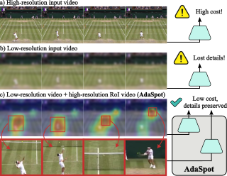

  <header class="project-title" style="text-align: center; margin-top: 2em">
    <h1 class="project-title" style="font-weight: bold; color: #404040">AdaSpot: Spend Resolution Where It Matters for Precise Event Spotting</h1>
    
IEEE/CVF Conference on Computer Vision and Pattern Recognition (CVPR), 2026

    <h3>
      <a href="https://scholar.google.es/citations?user=MNdw5eYAAAAJ&amp;hl=en" rel="external nofollow noopener" target="_blank">Artur Xarles</a>,
      <a href="https://scholar.google.com/citations?user=oI6AIkMAAAAJ&amp;hl=en&amp;oi=ao" rel="external nofollow noopener" target="_blank">Sergio Escalera</a>,
      <a href="https://scholar.google.es/citations?user=XmkDts4AAAAJ&amp;hl=en&amp;oi=ao" rel="external nofollow noopener" target="_blank">Thomas B. Moeslund</a>, and
      <a href="https://scholar.google.es/citations?user=n4BtpPsAAAAJ&amp;hl=en&amp;oi=ao" rel="external nofollow noopener" target="_blank">Albert Clapés</a>
    </h3>
    <h5>Universitat de Barcelona, Computer Vision Center, and Aalborg University</h5>
    

      <a href="https://arxiv.org/abs/2602.22073" class="btn" role="button" rel="external nofollow noopener" target="_blank">arXiv</a>
      <a href="https://github.com/arturxe2/AdaSpot" class="btn" role="button" rel="external nofollow noopener" target="_blank">Code</a>
    

  </header>

  

    <figure>
      
    </figure>
  

  

    

      <h3 style="text-align: center;">Abstract</h3>
      <i>Precise Event Spotting aims to localize fast-paced actions or events in videos with high temporal precision, a key task for applications in sports analytics, robotics, and autonomous systems. Existing methods typically process all frames uniformly, overlooking the inherent spatio-temporal redundancy in video data. This leads to redundant computation on non-informative regions while limiting overall efficiency. To remain tractable, they often spatially downsample inputs, losing fine-grained details crucial for precise localization. To address these limitations, we propose AdaSpot, a simple yet effective framework that processes low-resolution videos to extract global task-relevant features while adaptively selecting the most informative region-of-interest in each frame for high-resolution processing. The selection is performed via an unsupervised, task-aware strategy that maintains spatio-temporal consistency across frames and avoids the training instability of learnable alternatives. This design preserves essential fine-grained visual cues with a marginal computational overhead compared to low-resolution-only baselines, while remaining far more efficient than uniform high-resolution processing. Experiments on standard PES benchmarks demonstrate that AdaSpot achieves state-of-the-art performance under strict evaluation metrics (e.g., +3.96 and +2.26 mAP@0 frames on Tennis and FineDiving), while also maintaining strong results under looser metrics. Code is available at: <a href="https://github.com/arturxe2/AdaSpot">github.com/arturxe2/AdaSpot</a>.</i>
    

  

  

    

      <h3 style="text-align: center;">BibTeX</h3>
      

        <i>@inproceedings{xarles2026adaspot, 
          &emsp;title={AdaSpot: Spend Resolution Where It Matters for Precise Event Spotting}, 
          &emsp;author={Xarles, Artur and Escalera, Sergio and Moeslund, Thomas B. and Clap{\'e}s, Albert}, 
          &emsp;booktitle={Proceedings of the IEEE/CVF Conference on Computer Vision and Pattern Recognition (CVPR)}, 
          &emsp;year={2026} 
        }</i>
      

    

  

